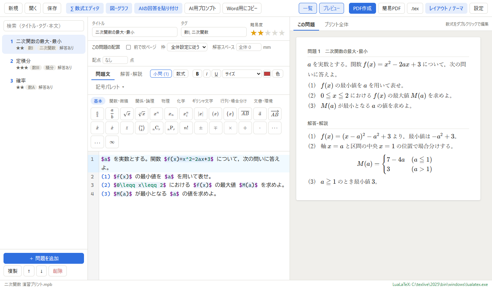

# LaTeX 問題エディタ

数学・物理・化学の問題と解答を書いて、プリントや入試問題の体裁の PDF を作るデスクトップアプリです（Windows / macOS）。
LaTeX を知らなくても、ふつうの文章と「(1) 」で始まる小問、数式エディタで書けます。LaTeX を知っていれば、そのまま LaTeX で書けます。



## ダウンロード

[Releases](https://github.com/WVYYYVW/GUI-LaTEX-Editor/releases/latest) から入手してください。

| OS | ファイル |
| --- | --- |
| Windows 10 / 11 | `LaTeX-Problem-Editor-Setup-<版>.exe` |
| macOS（Apple シリコン / M1 以降） | `LaTeX-Problem-Editor-<版>-mac-arm64.dmg` |
| macOS（Intel） | `LaTeX-Problem-Editor-<版>-mac-x64.dmg` |

- 新しい版が出ると、アプリが自動で知らせます（Windows は自動で入れ替わります。「ヘルプ → 更新を確認」でいつでも確かめられます。設定で切ることもできます）。
- **Windows** で「Windows によって PC が保護されました」と出たら、「詳細情報」→「実行」で入れられます。
- **macOS** で初めて開くときは、アプリを右クリック →「開く」。開けないときは「システム設定」→「プライバシーとセキュリティ」→「このまま開く」。「壊れているため開けません」と出るときは、ターミナルで次を実行してください。

  ```bash
  xattr -dr com.apple.quarantine "/Applications/LaTeX Problem Editor.app"
  ```

### PDF を作るには TeX が必要です

プレビューと「簡易PDF」は TeX が無くても使えます。きれいな PDF（「PDF作成」）には LuaLaTeX を使います。

- Windows: [TeX Live](https://www.tug.org/texlive/)
- macOS: [MacTeX](https://www.tug.org/mactex/)（容量の小さい BasicTeX を使う場合は、日本語などの部品を足します）

  ```bash
  sudo tlmgr update --self
  ```

  ```bash
  sudo tlmgr install collection-langjapanese collection-latexrecommended collection-pictures
  ```

TeX の場所は自動で探します（「設定」で指定もできます）。足りない部品があると、PDF を作るときにアプリが入れ方を表示します。

## 使い方

1. 「＋ 問題を追加」で問題を作り、問題文を書きます。
   - 小問は行の先頭に `(1) ` と書きます（Enter で次の番号が入ります）。番号の形（(1)・問1・⑴ など）はレイアウトで決まります。
   - 数式は「∑ 数式エディタ」（Ctrl/⌘+E）で見たまま入力するか、`$x^2+1$` のように LaTeX で書きます。プレビューの数式をダブルクリックしても編集できます。
2. 「解答・解説」も同じように書きます。
3. 「レイアウト / テーマ」で体裁を選び、「PDF作成」（Ctrl/⌘+Shift+B）を押します。

「一覧」「プレビュー」ボタン（Ctrl/⌘+Shift+L / P）で左右の欄を隠すと、エディタを広く使えます。

## できること

### 書く
- **LaTeX を知らなくても書ける**：`(1) ` で始まる行は小問になります。`\item`・`\begin{enumerate}` などの命令は、エディタでは「小問」「小問ここから」といった札で表示します（カーソルのある行は元の文字のまま）
- **数式エディタ**（MathLive）：`/` で分数、`^` で上付き、Tab で次の枠
- **記号パレット**：分数・積分・行列・場合分け・ベクトル・物理・化学の記号など
- **書式**：太字・斜体・下線・文字サイズ・色（数式の中では数式用の命令を使います）
- **全角の自動修正**：数式の中の `ｘ＋１` のような全角英数字を半角に直します
- **図・グラフ**：関数グラフ（式を入れるだけ）、点・線分・円の作図、物理の部品（ばね・抵抗・コンデンサー・電池・コイルなど）、画像。PDF では TikZ で描きます
- **物理・化学**：化学式 `\ce{H2SO4}`、単位 `\qty{9.8}{m/s^2}`、大問の中の「部」`\Part`、空欄 `\blank{ア}`

### 取り込む
- **AI の回答を貼り付け**（Ctrl/⌘+Shift+V）：Claude・ChatGPT などの回答を、数式・箇条書き・表ごと LaTeX に変換して取り込みます
- **AI 用プロンプト**：AI に問題を作らせるためのプロンプトを作ってコピーします。「問題だけ」か「問題と解答」か、科目、依頼の内容、出力の形式（貼り付け用 / `.mpb` ファイル）を選べます。貼り付け用は、一度貼るだけで問題文と解答をまとめて取り込めます
- **Word（.docx）から取り込む**：Word の数式（OMML）を LaTeX に変換し、大問・小問に分けて取り込みます
- **Word 用にコピー**（Ctrl/⌘+Shift+C）：数式を MathML としてコピーし、Word で編集できる数式として貼れます

### 体裁を整える
- **テーマ**：標準・シンプル・定期テスト風・国公立二次風など。「まっさら」から自分で一から作ることもできます
- **大学入試の体裁**：各大学が公開している問題冊子をもとに、大問番号の形・余白・1 行の字数などを近づけたテーマ（数学・物理・化学）
- **細かい調整**：大問の見出し（形・書体・大きさ・位置・自作の LaTeX）、余白、字下げ、小問番号、行送り、1 行の字数、用紙（A4/B5/B4/A3、縦横、2 段組）、配点、下書き用紙、ページ番号、表紙（試験時間・注意事項・受験番号欄）
- **LaTeX で調整**（上級者向け）：設定から作られる LaTeX を見て、書き足した命令で上書きできます
- 作った設定は「自分のテーマ」として保存できます

### 出力する
- **PDF作成**：LuaLaTeX で組版します。エラーは「問題 3（解答）2 行目」のように場所を示し、クリックでその行へ移動します
- **簡易PDF**：TeX が無くても、プレビューをそのまま PDF に保存します
- **.tex 書き出し**：ほかの環境でもコンパイルできる LaTeX ファイル

## ファイル形式

問題集は `.mpb` ファイル（中身は UTF-8 の JSON）に保存します。以前の `.mathprob` もそのまま開けます。
問題文・解答は LaTeX のテキスト、レイアウトは `meta.layout`、問題ごとの配置は `problems[].layout` に入ります。

## 大学入試の体裁テーマについて

公開されている問題冊子を画像にして位置を測り、体裁を近づけたものです。各大学・大学入試センターとは関係がなく、実物と完全には同じではありません（本文の書体は原ノ味明朝・Latin Modern で組みます）。問題文は含みません。表紙の注意事項は、実物と同じ趣旨の文を独自の言葉で書いています。

## 開発

Node.js 20 以上が必要です。

```bash
npm install
```

```bash
npm run dev
```

```bash
npm test
```

インストーラーを手元で作る場合（macOS 版は Mac 上で作ります）:

```bash
npm run dist:win
```

```bash
npm run dist:mac
```

### リリース

`v` で始まるタグ（例: `v0.4.0`）を push すると、GitHub Actions（[.github/workflows/build.yml](.github/workflows/build.yml)）が Windows / macOS のインストーラーを作り、Release に添付します。自動更新に使う `latest.yml`・`latest-mac.yml` も一緒に添付されます。

リポジトリの Secrets に証明書を登録すると、Windows（SSL.com eSigner）・macOS（Developer ID と公証）の署名も自動で行います。手順は [docs/signing.md](docs/signing.md) を見てください。macOS で自動の入れ替えができるのは署名した版だけで、署名していない版は新しい版を知らせてダウンロードのページを開きます。

### 構成

```
electron/              メインプロセス（ファイル、PDF 作成、自動更新）
  tex.js               TeX の検出・コンパイル、足りない部品の案内
  updater.js           自動更新
src/renderer/          画面
  lib/natural.js       「(1) 」で書いた小問 → LaTeX
  lib/editor.js        エディタ（CodeMirror 6）、命令の札の表示
  lib/preview.js       LaTeX → HTML プレビュー
  lib/texExport.js     LaTeX 文書の生成、エラー行の逆引き
  lib/layout.js        レイアウト・テーマ（HTML / LaTeX の両方を生成）
  lib/universityThemes.js  大学入試の体裁テーマ
  lib/figure.js        図・グラフ（TikZ / SVG）
  lib/smartPaste.js    AI の回答 → LaTeX
  lib/aiPrompt.js      AI 用プロンプト
  lib/docxImport.js    Word → LaTeX
  lib/wordExport.js    LaTeX → MathML（Word 用）
  layoutPanel.js       レイアウトの画面
scripts/               ビルドの補助
test/                  単体テスト
```
